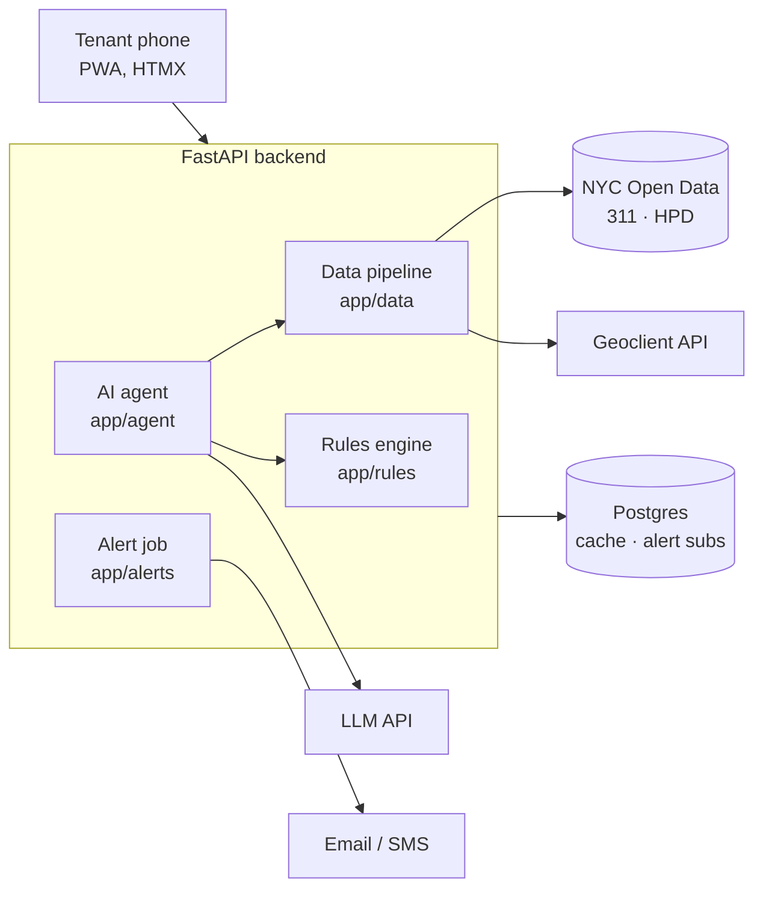

# Architecture

## Request flow

1. Tenant enters an address on `/`.
2. `/search` calls Geoclient to get the BIN and BBL, then redirects to `/building/{bin}`.
3. The report route fetches open HPD violations (by BIN) and recent HPD 311 complaints (by BBL), cached for one hour.
4. The rules engine evaluates each violation: overdue, due soon, on time, or closed.
5. The page renders server-side with HTMX; the service worker caches it for offline viewing.

## Design decisions

- **One agent, three tools.** `lookup_violations`, `check_deadlines`, `draft_letter`. Deadlines and violation facts always come from code, never from the LLM.
- **No accounts.** The only stored personal data is an alert contact, deleted on unsubscribe.
- **Server-rendered pages.** Small payloads for low-end phones; no heavy JS framework.
- **Dataset dates first.** When HPD provides a correct-by date, it overrides the class-based default.

## Data sources

| Source | ID | Key |
| --- | --- | --- |
| HPD Housing Maintenance Code Violations | `wvxf-dwi5` | BIN |
| 311 Service Requests | `erm2-nwe9` | BBL, agency = HPD |
| NYC Geoclient | — | Address → BIN/BBL |
