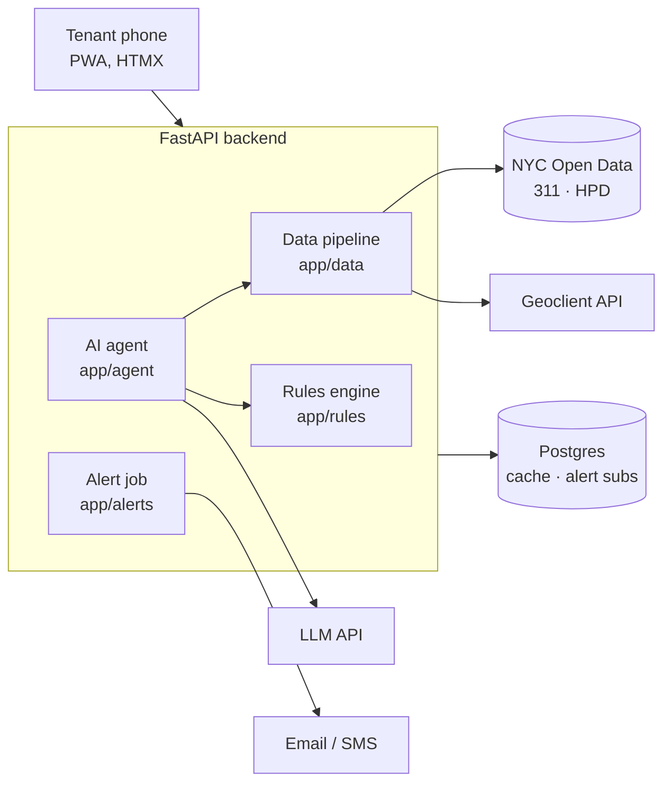

# Architecture

## Request flow

1. Tenant enters an address on `/`.
2. `/search` calls Geoclient to get the BIN and BBL, then redirects to `/building/{bin}`.
3. The report route fetches open HPD violations (by BIN) and recent HPD 311 complaints (by BBL), cached for one hour.
4. The rules engine evaluates each violation: overdue, due soon, on time, or closed.
5. The page renders server-side with HTMX; the service worker caches it for offline viewing.

## AI assistant flow

1. The client sends `message`, optional 7-digit `bin`, and `lang` (`en` or `es`) to `POST /agent/ask`.
2. The route normalizes the language and invokes the Gemini-backed agent. The API key and model are read from server-side environment settings.
3. Gemini receives the localized system prompt and the three function declarations: `lookup_violations`, `check_deadlines`, and `draft_letter`.
4. The agent executes requested functions from the server-side registry. HPD violations are fetched by BIN, and deadline calculations use the deterministic rules engine. Tool results are returned to Gemini for the next turn.
5. The loop allows at most six tool-call steps. A completed answer is checked for unsupported dates and incorrect HPD class labels before it is returned.
6. Common legal-advice requests receive a refusal with legal-aid and 311 guidance. Gemini request timeouts return HTTP 504.

Tool-call logs include the tool name and loop step, not the tenant's message or BIN. Tests mock Gemini and upstream HPD responses; they do not send fixture or tenant data to external services.

## Design decisions

- **One agent, three tools.** `lookup_violations`, `check_deadlines`, `draft_letter`. Deadlines and violation facts come from HPD and deterministic code; the LLM selects tools and explains returned results.
- **Provider secrets stay server-side.** Gemini credentials are configured with `LLM_API_KEY` and `LLM_MODEL`; never expose the key to browser code or commit it.
- **No accounts.** The only stored personal data is an alert contact, deleted on unsubscribe.
- **Server-rendered pages.** Small payloads for low-end phones; no heavy JS framework.
- **Dataset dates first.** When HPD provides a correct-by date, it overrides the class-based default.

## Data sources

| Source | ID | Key |
| --- | --- | --- |
| HPD Housing Maintenance Code Violations | `wvxf-dwi5` | BIN |
| 311 Service Requests | `erm2-nwe9` | BBL, agency = HPD |
| NYC Geoclient | — | Address → BIN/BBL |
